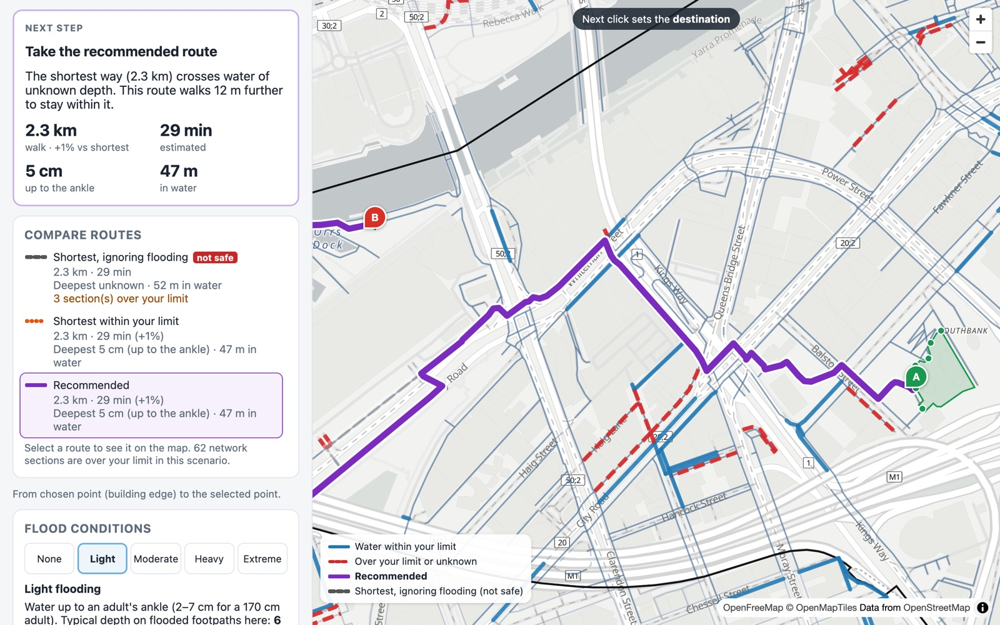
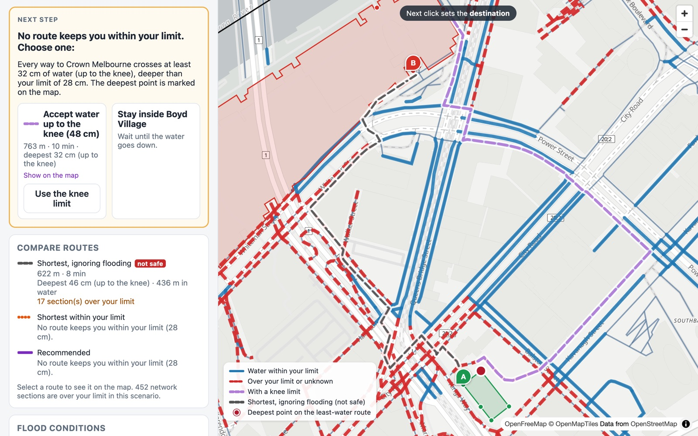
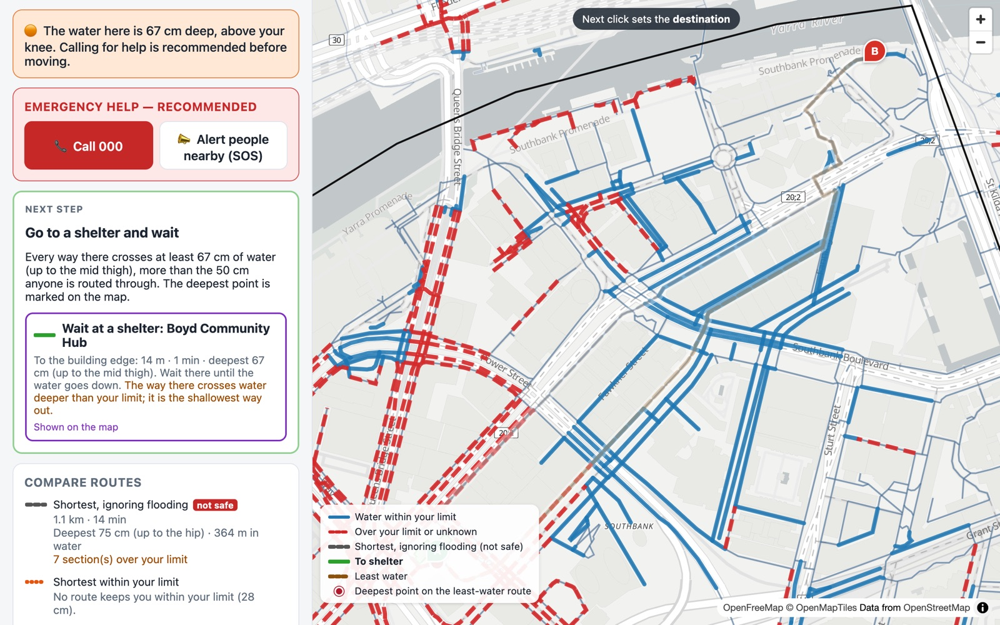
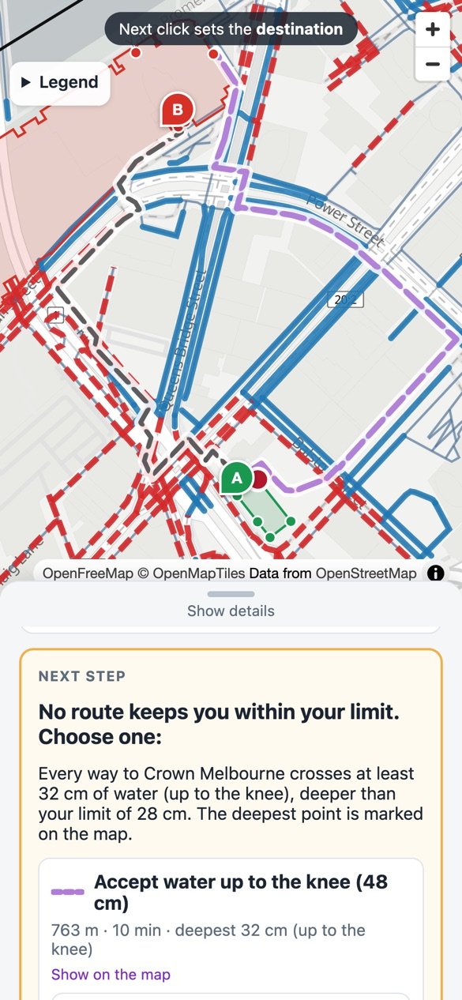

# Flood Risk-Aware Pedestrian Routing

Walking routes for Southbank, Melbourne that minimise exposure to flood hazards instead of only
distance. The routing engine works on a real pedestrian network; flood conditions come from
interchangeable sources (scenarios built from published flood levels and terrain today, sensors and forecasts later). Each traveller
sets the deepest water they accept as a body part, converted to a depth from their height; deeper
water is never routed through, and shallower water costs more the closer it is to that limit.

## Screenshots

Each trip opens with the next step to take, and the map highlights the route it refers to. Water
the traveller can walk through is blue; water over their limit, or of unknown depth, is dashed red.

**A route that fits.** Light flooding, ankle limit: the shortest way crosses water of unknown
depth, so the recommended route walks 12 m further to stay within the limit.



**No route fits: a choice.** Moderate flooding, Boyd Village to Crown Melbourne, mid-calf limit
(28 cm): every way crosses at least 32 cm, so the choices are to accept water up to the knee or to
stay inside. The deepest point on the way is marked.



**Standing in deep water.** Heavy flooding, starting in 67 cm: emergency help comes first, then the
nearest shelter by the shallowest way out.



**On a phone.** The map sits above a sheet that slides up; the legend starts folded.



## Repository layout

```
backend/                 Python package, scripts and tests (uv project)
  src/floodroute/        routing engine — see docs/architecture.md
    api/                 HTTP API for the web client (FastAPI)
  scripts/               data pipeline: download, build, validate
  tests/
  streamlit_app.py       Streamlit map UI, kept alongside the web client
frontend/                web client: React, TypeScript and MapLibre; phones and desktops
data/                    raw downloads and processed networks (git-ignored, rebuilt by scripts);
                         data/scenarios/ holds the flood scenario definitions (JSON)
docs/                    architecture, parameters and their basis, verification
```

## Getting started

Requires Python 3.12 and [uv](https://docs.astral.sh/uv/); the web client also needs Node.js 20.

```bash
cd backend
uv sync                                    # create .venv and install dependencies
uv run python scripts/download_data.py     # fetch OSM, City of Melbourne, terrain, overlay and drain data into data/raw
uv run python scripts/build_network.py     # build data/processed/southbank_network.gpkg and places
uv run python scripts/make_scenarios.py    # build the flood scenario depth grids into data/processed
uv run pytest                              # run the test suite
uv run ruff check && uv run ruff format --check  # lint and formatting
uv run python scripts/compare_pathfinders.py  # verify the in-house Dijkstra against NetworkX
uv run python scripts/verify.py            # cases A–F vs the predictions in docs/verification.md
uv run streamlit run streamlit_app.py      # open the Streamlit map UI
```

The web application:

```bash
cd frontend && npm install && npm run build   # build the web client into frontend/dist
cd ../backend && uv run uvicorn floodroute.api.app:app --port 8000
```

then open http://localhost:8000; the API serves the built client and its own routes under
`/api` (interactive reference at http://localhost:8000/docs). While working on the client, run
`npm run dev` in `frontend/` instead and open the address it prints; it passes `/api` requests to
the API on port 8000 (or wherever `FLOODROUTE_API_URL` points, e.g. `http://127.0.0.1:8010` when
port 8000 is taken) and reloads on every change.

`scripts/build_network.py --source com` builds the alternative City of Melbourne network, and
`scripts/validate_com_network.py` reports its topology and coverage against OpenStreetMap.
Both write maps and reports to `reports/` (git-ignored).

## Data sources

| Data | Source | Licence |
|---|---|---|
| Walking network, buildings, entrances | © OpenStreetMap contributors, via Overpass API / osmnx | ODbL |
| Southbank boundary (study area) | City of Melbourne, CLUE small areas | CC BY |
| Pedestrian network (alternative source) | City of Melbourne, Pedestrian Network | CC BY |
| Place search | OpenStreetMap Nominatim | ODbL; usage policy applies |
| Ground elevation | Geoscience Australia, 5 m LiDAR DEM (2025) | CC BY 4.0 |
| Flood overlays (LSIO, SBO, FO) | Vicmap Planning, Department of Transport and Planning | CC BY 4.0 |
| Stormwater pits | City of Melbourne, Stormwater Pits | CC BY |
| Flood mechanisms, tide levels and checks | Melbourne Water Southbank Local Floodplain Development Plan (2026); GHD for Melbourne Water (2017); Port Phillip Bay Coastal Hazard Assessment (2023); City of Melbourne flood and storm sub-plan (2025); VICSES Southbank Local Flood Guide (2021) | cited, not redistributed |
| Flood level boundaries | Feng, Brenner & Sester (2020); Drillis & Contini (1966); Smith, Davey & Cox (2014); ABS Australian Health Survey 2011–12 | cited |

## Contributing

See [CONTRIBUTING.md](CONTRIBUTING.md) for setup, branch and commit conventions, and checks to run
before opening a pull request.

## Safety notice

Routes are guidance based on modelled or reported conditions, which can be incomplete, out of date
or wrong, and flood conditions can change quickly. A suggested route is not a guarantee that it is
safe. Never walk, ride or drive through floodwater you do not have to, follow directions from
emergency services, and in an emergency call 000.

## Licence

Code is licensed under the [Apache License 2.0](LICENSE). See [NOTICE](NOTICE) for attribution.
Data listed above keeps its own licence; processed network files derived from OpenStreetMap are
covered by the ODbL and must credit OpenStreetMap if shared.
