# Walkthrough

Each situation the app handles, in a short clip of the web client. Back to the [README](../README.md).
To present them, the web client shows the same clips as slides at `/slides` (arrow keys, Space or a
swipe to move on); opened through a public link (`deploy/share.sh`), they end with QR codes of the
app.

Each trip opens with the next step to take, and the map highlights the route it refers to. Water
the traveller can walk through is blue; water over their limit, or of unknown depth, is dashed red.
Every route shows its length, time, deepest water, and its steepest and gentlest gradient where the
City of Melbourne has measured the footpaths.
The sources behind every flood level and depth limit, and which values are judgements, are on the
`/reference` page, and how the system is tested, with the latest results, on `/benchmark`; both are
reached only by their addresses.

**Flood levels.** From none to extreme: the typical water on flooded footpaths rises from the
ankle (6 cm) to the calf (32 cm), the thigh (54 cm) and above the hip (99 cm).

**Finding a place.** Light flooding, ankle limit: typing a name into the search boxes instead of
clicking the map. From Eureka Tower to Crown Melbourne the route is 570 m and dry, from the tower's
building edge to the main entrance.

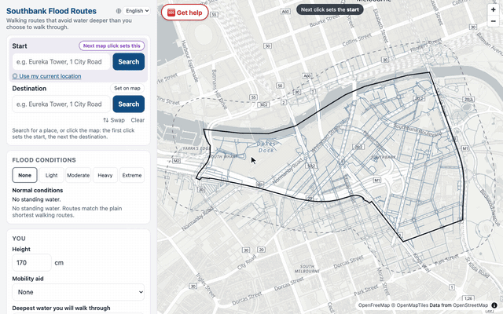

**A route that fits, around the water.** Light flooding, ankle limit: the shortest way crosses
water of unknown depth, so the recommended route walks 12 m further to stay within the limit.

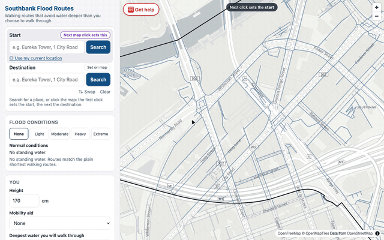

**Route preference.** Moderate flooding, knee limit, to Crown Promenade Hotel: water within the
limit is never forbidden, only weighed against distance. Balanced walks 608 m with 90 m in water,
Shortest 604 m with 100 m, and Stay as dry as possible 821 m with 55 m.

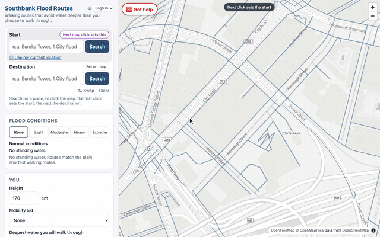

**No route fits: a choice.** Moderate flooding, Boyd Village to Crown Melbourne, mid-calf limit
(28 cm): every way crosses at least 32 cm, so the choices are to accept water up to the knee or to
stay inside. Taking the knee limit gives a route.

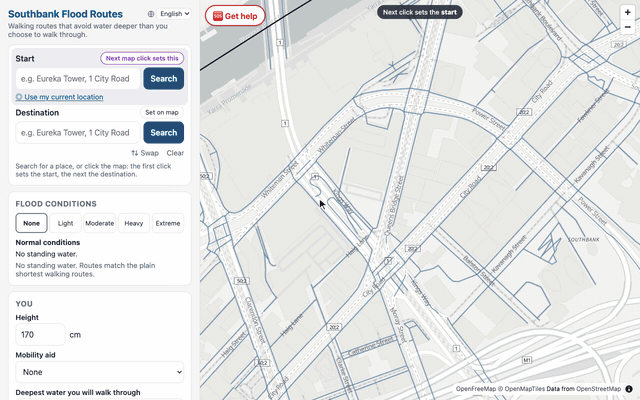

**Go to a shelter.** Heavy flooding, from dry ground: every way to the destination crosses at
least 68 cm, more than the 50 cm anyone is routed through, so the next step is the nearest shelter,
140 m away and dry all the way.

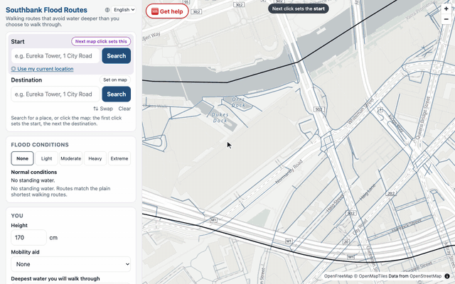

**Standing in deep water.** Heavy flooding, starting in 67 cm: emergency help comes first, then the
nearest shelter by the shallowest way out.

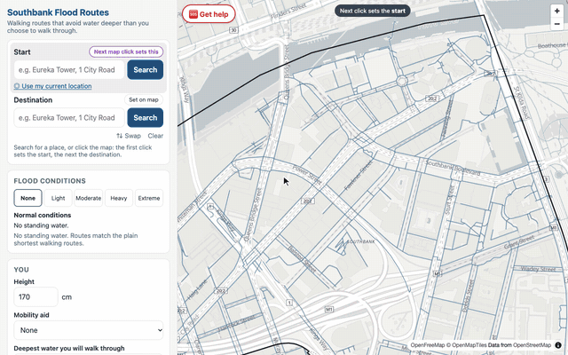

**Cut off inside a building.** Extreme flooding, inside Boyd Village: every way to Crown Melbourne
crosses at least 147 cm. Staying inside is the advice, and emergency help is available, with a
reminder to move to a higher floor if water comes in.

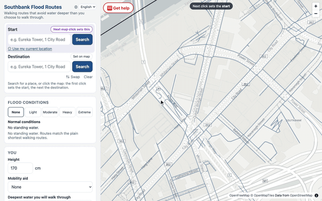

**With a wheelchair.** Light flooding, a manual wheelchair at its lowest level (no water, 2 cm),
from inside the Crown Entertainment Complex to Boyd Village: every step-free way crosses 3 cm, so
the choices are the device's next level, below a 4-inch castor axle (5 cm), or staying inside.
Each device has its own levels and cap (manual wheelchair 7.5 cm, powered wheelchair 5 cm,
mobility scooter 2.5 cm), and routes never use steps or footpaths measured steeper than 1:14.

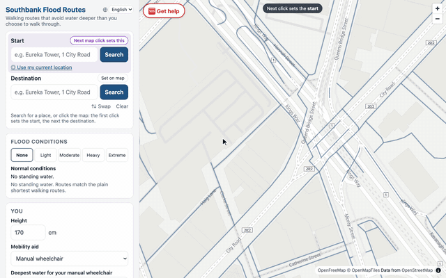

**Powered wheelchair and mobility scooter.** Light flooding, the same trip from inside the Crown
Entertainment Complex to Boyd Village, where every step-free way crosses 3 cm. A powered wheelchair
at its 5 cm level (well below the chassis) has a 379 m route. A mobility scooter is routed through
at most 2.5 cm, its cap, so it has none: it stays inside, with emergency help available.

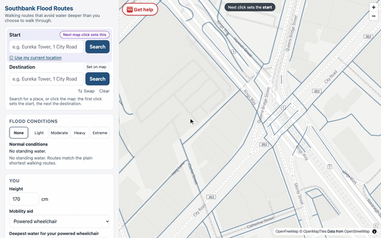

**Steep paths.** No flooding, on the promenade between Southgate Avenue and Southbank Boulevard:
on foot the route is 109 m and its steepest part is a path at 8.3%. With a manual wheelchair it
goes round that path, 429 m, and its steepest part is 6.9%: wheelchair and scooter routes never use
a path steeper than 1:14 (7.1%).

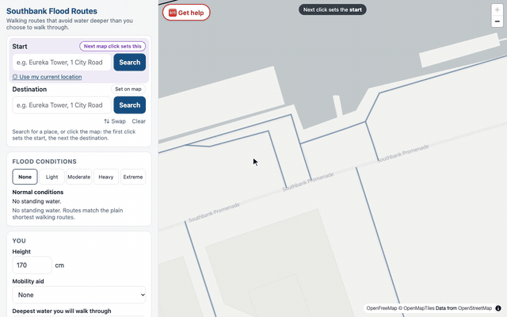

**Help at any time.** A Get help button stays on the map, whatever the trip says: call 000 if
anyone's life is in danger, VICSES 132 500 for flood or storm help, or alert people nearby (the
alert is simulated, with a few seconds to undo it).

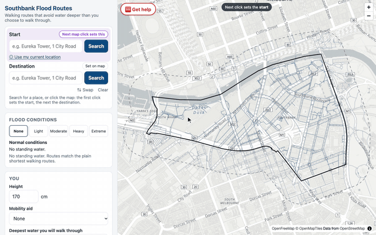

**On a phone.** The map sits above a sheet that slides up; the legend starts folded.

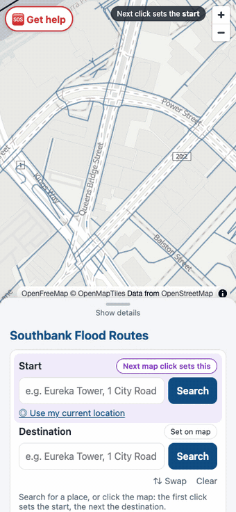
